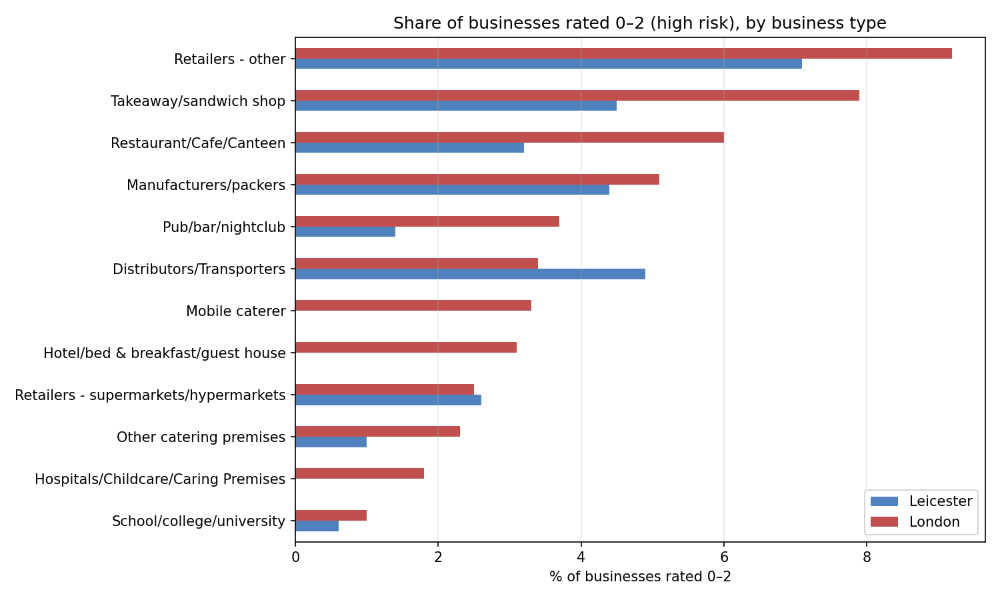
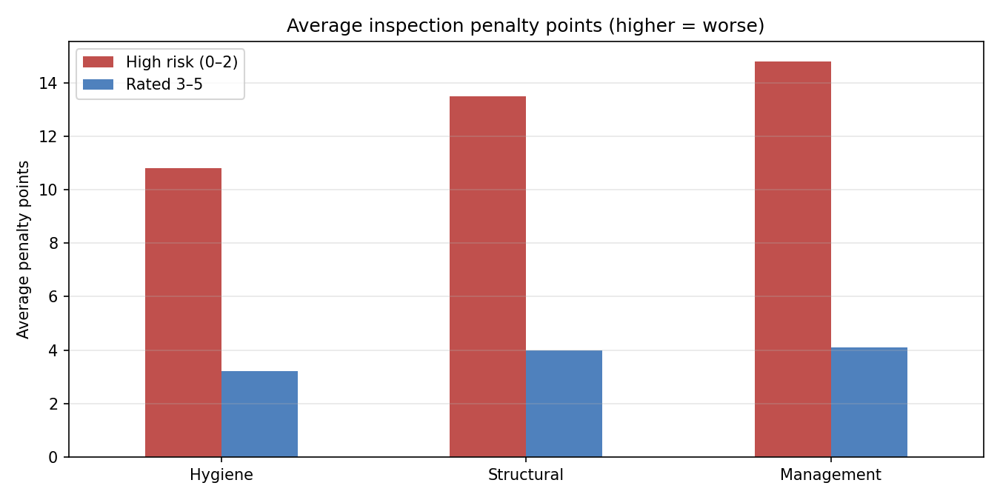
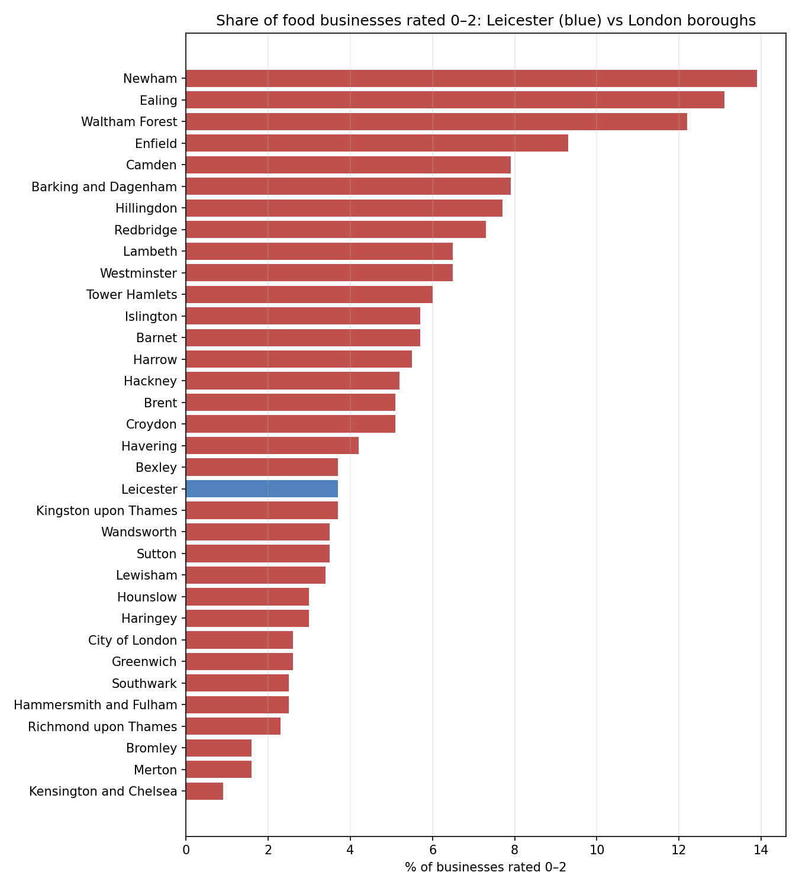

[README (1).md](https://github.com/user-attachments/files/33778580/README.1.md)
# Which food businesses are most at risk of failing a hygiene inspection?

An analysis of official Food Standards Agency (FSA) hygiene ratings for every food business in **Leicester** and all **33 London councils**, looking at which types of business are most likely to be rated 0–2 and what drives those low ratings.

Having worked front-of-house in restaurants and pubs in both Leicester and London, I wanted to understand where hygiene risk really sits in the businesses behind the "Scores on the Doors" sticker.

## Questions
1. What share of food businesses in each area are high risk (rated 0–2)?
2. Which types of business are riskiest: restaurants, pubs, takeaways or others?
3. What's behind low ratings: hygiene, the building, or management?
4. How does Leicester rank against each of London's 33 boroughs?

## Key findings
- **London is riskier than Leicester overall.** 5.7% of rated food businesses in London are high risk (rated 0–2), compared with 3.7% in Leicester. Leicester also has more businesses with the top rating of 5 (74.9% vs 68.5%).
- **Takeaways and small shops are the riskiest types; pubs are among the safest.** Small retailers (7.1% Leicester, 9.2% London) and takeaways (4.5% vs 7.9%) have the highest share of high-risk ratings. Pubs, bars and nightclubs are much lower (1.4% in Leicester, 3.7% in London).
- **London is worse in almost every category.** For takeaways, restaurants and pubs, London's high-risk share is roughly 1.7–2.6 times Leicester's.
- **Management is the biggest driver of low ratings.** High-risk businesses average 14.8 penalty points for confidence in management, compared with 4.1 for everyone else (a gap of 10.7). The gap is 9.5 points for structural issues and 7.6 for food hygiene.
- **Location matters more than the city.** Leicester ranks 19th out of 34 councils, in the middle of the London boroughs. But London varies hugely: Newham (13.9%), Ealing (13.1%) and Waltham Forest (12.2%) have over ten times the high-risk share of Kensington and Chelsea (under 1%).

## Recommendations
- **For restaurant and pub operators:** since management scores drive low ratings most, focus on staff food safety training, keeping records up to date and running regular self-checks before inspections. These are cheaper to fix than building issues.
- **For councils:** target inspection time at takeaways and small retailers, and at the boroughs where high-risk businesses are concentrated, such as Newham, Ealing and Waltham Forest.
- **For delivery platforms and customers:** takeaways carry above-average risk, so showing hygiene ratings clearly on delivery apps would help customers make informed choices.

## Tools
- **Python:** parsing the FSA's XML files, cleaning with Pandas, charts with Matplotlib
- **SQL (SQLite):** `GROUP BY` aggregation, `CASE WHEN`, `HAVING` filters, the `RANK()` window function and percentage calculations

## Data
[Food Standards Agency open data](https://ratings.food.gov.uk/open-data/), the official published hygiene ratings for every food business, downloaded per council (Leicester City: 878; London: 501–533).

## Definitions
- **High risk:** a rating of 0, 1 or 2 ("urgent improvement necessary" to "improvement necessary").
- **Inspection scores** are penalty points, so higher = worse.
- Businesses that are exempt or awaiting inspection are excluded.

## Limitations and next steps
- Ratings reflect the last inspection, which may be several years old for some businesses.
- Detailed scores aren't published for every business, so the drivers analysis uses only those available.
- The three scores use different scales (management goes up to 30 points, hygiene and structural up to 25), so the gaps are a guide rather than an exact like-for-like comparison.
- Overall, only 5.6% of rated businesses are high risk, so some smaller categories in Leicester have few high-risk businesses and their percentages should be read with care.
- Next step: check whether high-risk businesses are re-inspected quickly.

## How to run
Open `food_hygiene_risk_analysis.ipynb` in Google Colab or Jupyter and run all cells. The data downloads automatically.
